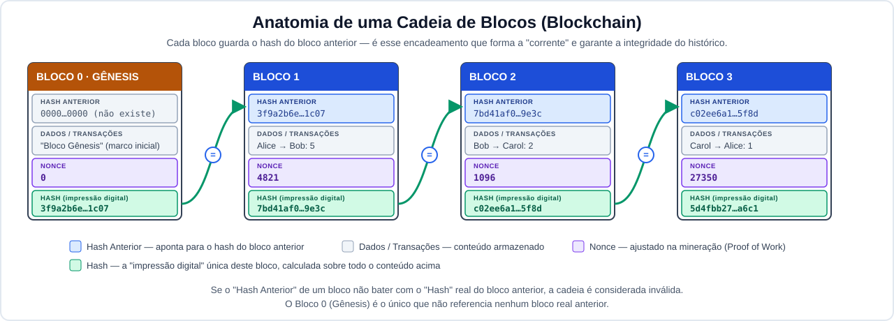
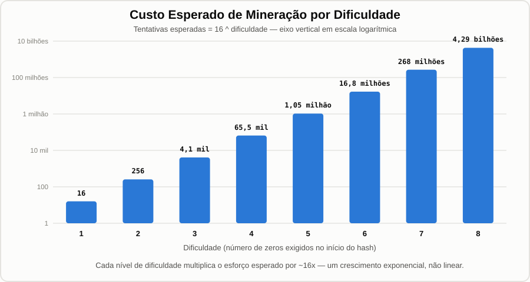
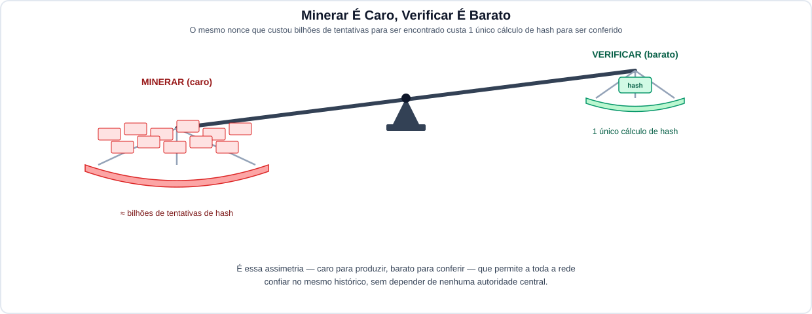

# Lab Prático: Introdução a Blockchain em Python

Um laboratório introdutório (~1h) para entender, na prática, os quatro
pilares de um blockchain implementado em Python: **hashing e
encadeamento de blocos**, **detecção de adulteração**, **Mineração via Prova de Trabalho**
e **assinaturas digitais / carteiras**.

## Pré-requisitos

- Python 3.8+
- Conhecimento básico de Python (classes, funções)
- Não é necessário conhecimento prévio de criptografia

---

## Atividade 1 — Blocos, Hashing e Encadeamento

Antes de começar, olhe esta figura — ela resume visualmente tudo o que
você vai construir e observar nos 4 passos:



Repare em três coisas nessa figura, que vão ficar mais claras a cada
passo abaixo: (1) cada bloco guarda **quatro** informações essenciais —
o `Hash Anterior` (o "ponteiro" para trás), os `Dados/Transações`, o
`Nonce` (usado na mineração) e o próprio `Hash` (a impressão digital do
bloco); (2) a seta verde mostra que o `Hash` de um bloco é copiado,
literalmente, para o campo `Hash Anterior` do próximo — é isso que forma
a corrente; e (3) o `Bloco 0` é o **gênesis**: o único que não aponta
para nenhum bloco real anterior.

Pré-requisito (uma vez só):

```bash
cd lab_blockchain
pip install -r requirements.txt
```


### 1.1 — Montando um bloco manualmente

Um bloco de blockchain nada mais é do que um pacote de dados, mais um
`previous_hash` (o elo com o bloco anterior) e um `hash` próprio,
calculado sobre **todo** o conteúdo do bloco — índice, timestamp,
transações, previous_hash e nonce — serializado em JSON.

Neste passo você vai digitar uma transação de exemplo, montar um bloco
com ela e ver, lado a lado, o conteúdo exato que foi serializado e o
hash calculado a partir dele.

```
python3 scripts/build_block.py
```

Observe o hash que foi calculado no processo anterior. Pense no hash
como uma "impressão digital" única deste conteúdo exato. 

O bloco também é salvo em `bloco_exemplo.json`, vamos visualizar seu conteúdo:

```
cat bloco_exemplo.json
```

Agora, tente calcular o hash desse bloco manualmente, e compare com valor
retornado pelo comando de criação inicial:

```
sha256sum bloco_exemplo.json
```

Os hashes são diferentes! Por quê?

Vamos seguir os mesmo passos que a rotina `compute_hash()` fez no script
inicial. Primeira questão é remover o próprio hash do bloco, já que vamos
justamente calcular o hash agora:

```
jq 'del(.hash)' bloco_exemplo.json
```

Agora o bloco contém apenas os dados necessários, porém para garantir que
a ordem dos dados sempre será a mesma e remover as quebras de linha, faça:

```
jq -Sjc 'del(.hash)' bloco_exemplo.json
```

Finalmente, vamos encadear o comando acima e calcular o hash:

```
jq -Sjc 'del(.hash)' bloco_exemplo.json | sha256sum
```


**O que observar:** o hash "calculado na mão" bate exatamente com o
hash que o `Block` calculou sozinho — porque são os mesmos dados, o mesmo
passo a passo. O hash não é gerado por mágica nem por um segredo do programa:
é uma função pura do conteúdo, que qualquer pessoa, em qualquer
computador, consegue reproduzir.

### 1.2 — Encadeando blocos: onde a "corrente" realmente mora

Agora vamos construir uma cadeia de verdade. Uma `Blockchain` começa com
um **bloco gênesis** (o primeiro, sem antecessor real) e cada bloco
novo guarda, no campo `previous_hash`, o hash exato do bloco anterior.
É essa referência — e não uma simples numeração — que forma a
"corrente" do blockchain: cada elo aponta criptograficamente para trás.

Neste passo você escolhe quantos blocos criar e o conteúdo de cada um.
Depois de cada bloco minerado, o script confirma explicitamente que o
`previous_hash` do novo bloco bate com o `hash` do bloco anterior.

```bash
python3 scripts/build_chain.py
```

Note que aparece um texto comum em todos os passos: **Bloco XX minerado (nonce=YY, zz tentativas)**

Esse é o processo de mineração! vamos chegar lá em breve.

**O que lembrar:** a visualização final da cadeia, com cada bloco
apontando para o hash do anterior. Se você entende esse desenho, você
entende a estrutura central de um blockchain.

> [!IMPORTANT]  
> Por que a segurança do encadeamento depende do campo `previous_hash` apontar para o hash real do bloco anterior, e não bastaria simplesmente numerar os blocos em ordem (`index`)?
> 
> <input type="radio" name="resposta_ativ1_encadeamento" id="id101" value="hash-depende-conteudo" /> <label for="id101">Porque o `previous_hash` é calculado a partir do conteúdo real do bloco anterior — qualquer alteração nesse bloco muda seu hash e deixa de bater com o `previous_hash` guardado no bloco seguinte, expondo a adulteração. Uma numeração sequencial não tem essa propriedade: bastaria renumerar os blocos para "consertar" a fraude.</label><br>
> <input type="radio" name="resposta_ativ1_encadeamento" id="id102" value="index-opcional" /> <label for="id102">Porque o campo `index` é apenas decorativo na implementação e pode ser removido sem afetar a validação da cadeia.</label><br>
> <input type="radio" name="resposta_ativ1_encadeamento" id="id103" value="hash-mais-compacto" /> <label for="id103">Porque um hash SHA-256 ocupa menos espaço em disco do que um número inteiro sequencial, tornando a blockchain mais rápida de processar.</label><br>
> <input type="radio" name="resposta_ativ1_encadeamento" id="id104" value="script-recusa-fora-de-ordem" /> <label for="id104">Porque o script de validação recusa a execução caso o `index` dos blocos não seja estritamente sequencial, e é essa checagem — não o hash — que impede a fraude.</label><br>

### 1.3 — Onde mora a segurança? Tente atacar a cadeia você mesmo

Chegou a sua vez de tentar "passar a perna" no sistema: escolha um
bloco já existente da sua cadeia e mude o conteúdo dele diretamente,
como um atacante faria para, por exemplo, apagar uma dívida ou inflar
um saldo — sem re-minerar, ou seja, sem recalcular o hash certo.

(Pré-requisito: você precisa ter rodado o Passo 2 antes — este script
carrega o arquivo `cadeia.json` gerado por ele.)

Execute o comando abaixo e escolha um dos blocos criados anteriormente 
para "adulterar" seu contúdo, e forneça um conteúdo diferente (você pode
apenas pressionar ENTER para usar valores padrões).

```bash
python3 scripts/tamper_attack.py
```

Agora vamos verificar a integridade da cadeia:

```bash
python3 scripts/check_validity.py
```

Note que `is_chain_valid()` mostra a fraude sendo detectada!

**É aqui que mora a segurança do processo**: qualquer participante da rede consegue
recalcular o hash de um bloco a partir do seu conteúdo e comparar com o
hash guardado (e com o `previous_hash` do próximo bloco). Não existe
"confiar" em ninguém — é só matemática que qualquer um pode conferir
sozinho, a qualquer momento.

### 1.4 — Por que não basta "corrigir" o hash?

Você pode pensar: "o atacante só precisa recalcular o hash certo depois
de mudar os dados, aí ninguém percebe". Vamos exercitar essa ideia e ver se ela funciona:

```
python3 scripts/tamper_fix_attempt.py
```

Agora vamos checar a validade da blockchain adulterada com hash correto?

```
python3 scripts/check_validity.py cadeia_adulterada2.json
```

Observe que o resultado foi **is_chain_valid() -> False** e a mensagem de erro nós dá uma idéia do que ocorreu: *Bloco 3: previous_hash não corresponde ao hash real do bloco 2 (cadeia quebrada!).*

Você poderia ainda pensar: basta mudar o `previous_hash` da cadeira seguinte! :-) vamos testar essa opção? Utilize a saída do comando anterior para substituir o Hash Antigo e Hash Novo no comando abaixo:

```
sed -e s/HASH-ANTIGO/HASH-NOVO/g cadeia_adulterada2.json > cadeia_adulterada3.json
```

Será que agora a validade da blockchain adulterada com `hash` e `previous_hash` vai ser confirmada?

```
python3 scripts/check_validity.py cadeia_adulterada3.json
```

Mais uma vez falhou, né?! O resultado foi novamente **is_chain_valid() -> False**

Nos testes acima, mesmo com o hash do bloco atacado "corrigido" manualmente, e mesmo alterando o hash do próximo bloco, a cadeia
continua inválida — agora o hash do bloco seguinte mudou com a mudança do `previous_hash`. A corrente quebrou ali. Para o ataque
funcionar de verdade, o atacante precisaria 
atualizar o bloco adulterado **e todos os que vêm depois
dele**, mais rápido do que o resto da rede honesta consegue produzir
novos blocos. 
Além disso, tem um aspecto muito importante do blockchain que ainda não discutimos que é o nonce e o processo de mineração (Proof of Work) que vamos estudar em seguida, mas que torna esse tipo de adulteração muito custoso computacionalmente e pouco vantajoso! É um custo computacional crescente que, na prática,
protege o histórico de um blockchain.

Só um último detalhe: vamos lembrar o **efeito avalanche** do hash criptográfico? Efeito avalanche?! Bom, uma função hash
transforma qualquer texto em uma sequência fixa de caracteres, e mudar
**um único caractere** no texto de entrada muda o hash **inteiro**, de
forma completamente imprevisível — o chamado **efeito avalanche**. Vamos testar na prática? Execute:

```
python3 scripts/hash_avalanche.py
```

No exemplo anterior, você digita uma frase, vê o hash dela, muda só um detalhe (por
exemplo, trocar "10" por "11") e observa os dois hashes resultantes completamente diferentes! Somando o efeito avalanche com o processo de mineração (aguenta ai, já vamos estudá-lo), a blockchain fica bem robusta a ataques de adulteração.

> [!IMPORTANT]  
> Nos testes da seção 1.4, mesmo depois de corrigir manualmente o `hash` do bloco atacado e, em seguida, o `previous_hash` do bloco seguinte, a cadeia continuou inválida. Descreva, com suas palavras, até onde o atacante precisaria propagar essas correções para finalmente conseguir uma cadeia "válida" de ponta a ponta — e por que isso é, na prática, computacionalmente inviável para um bloco antigo em uma rede com muitos mineradores honestos ativos.
> 
> <textarea name="resposta_ativ1_propagacao_ataque" rows="6" cols="80" placeholder="Escreva sua resposta aqui...">
> </textarea>

### 1.4 - Resumo

Você viu, na prática:

- por que um hash muda completamente com qualquer alteração (efeito avalanche);
- como um bloco é montado e "assinado" pelo seu próprio hash — e que dá
  para reproduzir esse cálculo na mão, sem mágica nenhuma;
- como o `previous_hash` forma a corrente entre blocos;
- e, principalmente, onde exatamente mora a segurança do processo —
  verificação matemática pública (que qualquer um pode rodar sozinho,
  isoladamente), reforçada pelo custo de re-minerar (Proof of Work).

---

# Ativdade 2 — Mineração por Prova de Trabalho / Proof of Work

Minerar um bloco significa procurar, por tentativa e erro, um valor de
`nonce` que faça o hash do bloco começar com um número 
de zeros (`dificuldade`). Não existe atalho matemático conhecido — a única forma de
achar esse número é força bruta — mas qualquer pessoa pode **conferir**
o resultado final instantaneamente.

Olhe este gráfico antes de começar:



Repare que o eixo vertical está em **escala logarítmica** — cada linha
horizontal representa 100x mais tentativas que a anterior. Mesmo assim,
as barras crescem visivelmente: é isso que significa "crescimento
exponencial". Nos passos abaixo você vai gerar esses números você
mesmo, na sua própria máquina.

### 2.1 - Por que existe a Mineração e Prova de Trabalho?


O problema é que um blockchain não tem uma autoridade central decidindo
"qual é o próximo bloco válido". A rede é formada por muitos nós que não
confiam uns nos outros por padrão — não existe um servidor único, nem um
administrador, que possa simplesmente dizer "pode confiar, esse bloco é
o oficial". 

A Mineração por Prova de Trabalho resolve esse problema de duas formas
complementares:

**1. Ele torna caro propor um bloco novo.** Encontrar um nonce válido
exige, em média, um número enorme de tentativas de hash (você vai medir
isso na prática nos passos a seguir). Esse custo computacional real —
em energia, hardware e tempo — é o que impede qualquer nó de simplesmente
inventar blocos à vontade. Mais importante ainda: esse custo é o que
torna a reescrita do histórico praticamente inviável. Se alguém quisesse
alterar um bloco antigo, precisaria re-minerar aquele bloco e **todos os
blocos seguintes** — e faria isso competindo contra o restante da rede
honesta, que continua minerando blocos novos no topo da cadeia real
enquanto isso. Quanto mais blocos de diferença, mais improvável fica
alcançar e ultrapassar a cadeia legítima.

**2. Ele mantém barato verificar um bloco já minerado.** Apesar de caro
para *encontrar*, um nonce válido é baratíssimo para *conferir*: basta
qualquer nó recalcular o hash uma única vez e checar se ele satisfaz a
dificuldade. É essa assimetria — caro para produzir, barato para
verificar — que permite que todos os nós da rede cheguem a um consenso
sobre qual é o histórico válido, sem precisar confiar uns nos outros nem
depender de uma autoridade central: quem encontrou o nonce "pagou o
pedágio" computacional, e qualquer pessoa pode confirmar isso
instantaneamente.



### 2.2 — Por que existe o Nonce?

Antes de minerar de verdade, vale entender um ponto que costuma passar
batido: por que o bloco precisa de um campo `nonce` para começo de
conversa? Por que não simplesmente ficar recalculando o hash até ele dar
certo?

A resposta começa em um fato que você já viu na Parte 1: o hash
é **determinístico**. Para um conteúdo fixo, o hash é sempre exatamente
o mesmo — não existe "tentar de novo e torcer para dar sorte" sem mudar
alguma coisa na entrada. Vamos testar? 

```
echo -n "nonce=0;transacao=Alice paga 5 moedas para Bob" | sha256sum
```

Agora repita o comando acima duas ou três vezes. 

Reparou? O hash é
sempre EXATAMENTE o mesmo. É o efeito avalanche da Parte 1 visto de
outro ângulo: para um conteúdo fixo, o hash é determinístico - não
existe 'tentar de novo e torcer pra dar sorte'. 

Vamos ver uma forma ERRADA de resolver isso...

Ideia (ruim): e se, a cada tentativa, colarmos um número no FINAL da
transação, só para mudar o hash? Execute o script abaixo para testar essa ideia:

```
DIFICULDADE=00; i=1; time while true; do T="Alice paga 5 moedas para Bob #$i"; H=$(echo -n "nonce=0;transacao=$T" | sha256sum); if echo $H | grep -q "^$DIFICULDADE"; then echo -e "\n  transacao=$T\n  hash=$H"; break; fi; i=$(($i+1)); done
```

Funcionou? Quanto tempo levou?

Mude a dificuldade para 3 zeros e veja a nova duração do processo.

Funcionou! Em ambos os casos, depois de várias tentativas, achamos um hash válido.
Mas olhe o que sobrou no campo de dados do bloco: `transacao=Alice paga 5 moedas para Bob #6183`

Isso é um problema sério: os DADOS do bloco não são mais
"Alice paga 5 moedas para Bob" — viraram lixo com um número colado
no final, só para caçar um hash válido. Numa blockchain de verdade,
os dados são transações ASSINADAS pelos usuários — o
minerador nem PODE alterá-las sem invalidar a assinatura da pessoa
que autorizou a transação.

A forma correta: o **nonce**

A solução real é adicionar ao bloco um campo que NÃO TEM significado
nenhum — o nonce — cuja única função é dar ao minerador algo para
variar, sem tocar nos dados de verdade.

Execute agora o teste abaixo que faz uso do nonce com dificuldade=3:

```
DIFICULDADE=000; i=1; time while true; do T="Alice paga 5 moedas para Bob"; H=$(echo -n "nonce=$i;transacao=$T" | sha256sum); if echo $H | grep -q "^$DIFICULDADE"; then echo -e "\n  transacao=$T\n  nonce=$i\n  hash=$H\n"; break; fi; i=$(($i+1)); done
```

A saída deve ser algo similar a:

```
root@0df3aa41ff43:/lab# DIFICULDADE=000; i=1; time while true; do T="Alice paga 5 moedas para Bob"; H=$(echo -n "nonce=$i;transacao=$T" | sha256sum); if echo $H | grep -q "^$DIFICULDADE"; then echo -e "\n  transacao=$T\n  nonce=$i\n  hash=$H\n"; break; fi; i=$(($i+1)); done

  transacao=Alice paga 5 moedas para Bob
  nonce=5133
  hash=000fd7ab715b9edf33bf1a43cb3aa995bb4cbbff900508b6193ce2934c676331  -


real	0m24.247s
user	0m6.509s
sys	0m26.019s
```

Deu certo! Agora temos um hash que satisfaz a dificuldade, mas agora a
transação continua exatamente como a Alice a criou. O nonce é, por
design, o único campo 'descartável' do bloco: ele existe
especificamente para isso, e só para isso.

**Curiosidade**: no Bitcoin real, o campo nonce tem só 32 bits (~4,3
bilhões de valores) — em dificuldades muito altas, isso não é nem
suficiente! Quando os 4,3 bilhões de valores se esgotam, os
mineradores fazem algo parecido com o 'jeito errado' que você viu
acima: eles mudam um campo da PRÓPRIA transação de recompensa
(chamado extraNonce) — que é deles para mexer, sem afetar as
transações dos usuários.

> [!IMPORTANT]  
> Por que a mineração usa um campo `nonce` dedicado, em vez de simplesmente variar os dados da própria transação até encontrar um hash que satisfaça a dificuldade (como no experimento "ideia ruim" acima)?
> 
> <input type="radio" name="resposta_ativ2_nonce" id="id201" value="nonce-preserva-dados" /> <label for="id201">Porque variar os dados da transação mudaria o conteúdo real (por exemplo, o valor transferido), corrompendo a informação que os usuários assinaram; o nonce existe justamente como um campo sem significado, livre para o minerador variar sem tocar nos dados de verdade.</label><br>
> <input type="radio" name="resposta_ativ2_nonce" id="id202" value="nonce-obrigatorio-por-norma" /> <label for="id202">Porque a existência de um campo nonce é uma exigência regulatória em implementações de blockchain, e não uma questão técnica.</label><br>
> <input type="radio" name="resposta_ativ2_nonce" id="id203" value="sha256-precisa-de-nonce" /> <label for="id203">Porque sem o nonce o SHA-256 não conseguiria, em nenhuma hipótese, gerar hashes que comecem com zeros, independentemente de quais dados forem usados.</label><br>
> <input type="radio" name="resposta_ativ2_nonce" id="id204" value="transactions-somente-leitura" /> <label for="id204">Porque o campo `transactions` é somente leitura na classe `Block`, tornando tecnicamente impossível variar os dados da transação.</label><br>

### 2.3 — Minerando um bloco com a dificuldade que você escolher

Execute o script abaixo e veja na prática a mineração ocorrendo, ou seja
o nó minerador testando diversos valores de nonce até que o hash resultante
esteja de acordo com a dificuldade (por padrão 5 zeros). Com isso, 
veja o `nonce` sendo encontrado, junto com quantas tentativas
e quanto tempo isso levou.

```
python3 scripts/prova_de_trabalho.py
```

Repita o passo novamente testando outras dificuldades, por exemplo: `python3 scripts/prova_de_trabalho.py 6`


### 2.4 — Medindo o hash rate da sua máquina e estimando o custo futuro

Este passo mede quantos hashes SHA-256 por segundo a sua máquina
consegue calcular (calibrando por meio segundo) e, com esse número,
**estima** — sem minerar de verdade — quanto tempo dificuldades bem
mais altas (6, 7, 8...) levariam.

```bash
python3 scripts/hash_rate.py
```

**O que observar:** a diferença entre dificuldade 6 (segundos) e
dificuldade 8 (horas, na sua CPU rodando Python) é gigantesca. Mineradores
de Bitcoin reais usam hardware dedicado (ASICs) muito mais rápido que
isso, mas a rede também ajusta a dificuldade global constantemente, para
manter o tempo médio de mineração em ~10 minutos por bloco, não importa
quanto poder computacional total exista.

### 2.5 — Simulando uma corrida entre dois mineradores

Na vida real, vários mineradores competem ao mesmo tempo para minerar o
próximo bloco. Este passo simula dois "mineradores" tentando minerar o
mesmo bloco (com uma pequena diferença: cada um inclui seu próprio
endereço na recompensa) e mostra quem encontra um nonce válido primeiro.

```bash
python3 scripts/mining_race.py
```

**O que observar:** rode o script mais de uma vez — o vencedor muda,
porque o hash é imprevisível. Isso é a "loteria" da mineração: ter mais
poder computacional aumenta suas CHANCES de vencer mais rodadas ao
longo do tempo, mas não garante vencer uma rodada específica.

> [!IMPORTANT]  
> Você mediu o hash rate da sua própria máquina e viu, na simulação da corrida de mineração, que o vencedor muda a cada execução. Na rede real do Bitcoin, a dificuldade é reajustada automaticamente a cada ~2016 blocos para manter a média de ~10 minutos por bloco, não importa quanto poder computacional total exista minerando. Explique, com suas palavras, o que aconteceria com a segurança da rede (tempo médio por bloco, custo de um ataque de reescrita do histórico) se, de uma hora para outra, o poder computacional total dedicado à mineração dobrasse — e por que o ajuste automático de dificuldade é importante para essa segurança.
> 
> <textarea name="resposta_ativ2_ajuste_dificuldade" rows="6" cols="80" placeholder="Escreva sua resposta aqui...">
> </textarea>


### Fim da Atividade 2

Você viu, na prática, por que o Proof of Work funciona como mecanismo
de segurança: encontrar um nonce válido é caro (cresce exponencialmente
com a dificuldade), mas verificar um nonce já encontrado é barato (um
único cálculo de hash). É essa assimetria — caro para atacar, barato
para verificar — que protege o histórico de um blockchain.

---

# Atividade 3 — Assinaturas Digitais e Carteiras

Um blockchain não serve só para guardar dados — ele também precisa
provar QUEM autorizou cada transação, sem uma autoridade central. É
isso que a criptografia de chave pública (o mesmo princípio usado pelo
Bitcoin e pela Ethereum) resolve.

Olhe esta figura antes de começar:


Repare na divisão da figura: tudo do lado esquerdo (a chave privada) só
a Alice tem. Tudo do lado direito (a chave pública/endereço, a
assinatura, a mensagem) qualquer pessoa pode ter e conferir — mas o
resultado da verificação muda se a mensagem foi alterada depois de
assinada.


### 3.1 — Criando carteiras (pares de chaves)

Uma "carteira" aqui é só um par de chaves ECDSA: uma chave privada
(secreta) e uma chave pública (o "endereço"). Este passo cria uma
carteira para a Alice e uma para o Bob.

```bash
python3 scripts/create_wallet.py
```

**Importante:** o endereço (chave pública) pode ser compartilhado
livremente — é basicamente a identidade pública de alguém na rede.
A chave privada NUNCA deve ser compartilhada: quem a possui pode
assinar (autorizar) transações em seu nome.

Observe que as carteiras foram salvas em `carteira_alice.json` e 
`carteira_bob.json`. Verifique o conteúdo desses arquivos com o 
comando `cat`.

Note que salvar a chave privada em um arquivo .json sem proteção,
como fizemos aqui, é só para fins didáticos — nunca faça isso com
dinheiro de verdade.


### 3.2 — Criando e assinando uma transação

Agora a Alice cria uma transação enviando moedas para o Bob, e assina
essa transação com a própria chave privada.

```bash
python3 scripts/sign_transaction.py
```

**O que observar:** a assinatura é gerada a partir do conteúdo exato da
transação (remetente, destinatário, valor) usando a chave privada da
Alice. É a assinatura que compõe o lado "sign()" da figura.


### 3.3 — Verificando a assinatura com a chave pública

Este passo carrega a transação assinada e verifica a assinatura — mas
usando só a chave PÚBLICA da Alice, nunca a privada.

```bash
python3 scripts/verify_signature.py
```

**O que observar:** `is_signature_valid()` retorna `True`. Qualquer
pessoa com acesso à transação, à assinatura e ao endereço da Alice
consegue fazer essa mesma verificação — é o lado "verify()" (ramo de
cima) da figura.


### 3.4 — Tentando fraudar uma transação já assinada

E se alguém interceptar a transação assinada e mudar o valor antes de
ela ser processada?

```bash
python3 scripts/tamper_transaction.py
```

**O que observar:** a verificação passa a retornar `False`. É o ramo de
baixo da figura: a mesma assinatura, a mesma chave pública, mas uma
mensagem diferente da que foi originalmente assinada — e o resultado
muda. É o efeito avalanche da Parte 1, aplicado agora a assinaturas.

> [!IMPORTANT]  
> O que exatamente uma assinatura digital válida (`is_signature_valid() -> True`) garante sobre uma transação?
> 
> <input type="radio" name="resposta_ativ3_garantia_assinatura" id="id301" value="integridade-e-autoria" /> <label for="id301">Garante que o conteúdo exato da transação (remetente, destinatário, valor) não foi alterado desde que foi assinado, e que a assinatura só poderia ter sido gerada por quem possui a chave privada correspondente ao endereço do remetente.</label><br>
> <input type="radio" name="resposta_ativ3_garantia_assinatura" id="id302" value="saldo-suficiente" /> <label for="id302">Garante que o saldo do remetente é suficiente para cobrir o valor da transação.</label><br>
> <input type="radio" name="resposta_ativ3_garantia_assinatura" id="id303" value="confidencialidade" /> <label for="id303">Garante que o conteúdo da transação está criptografado e não pode ser lido por terceiros.</label><br>
> <input type="radio" name="resposta_ativ3_garantia_assinatura" id="id304" value="identidade-real" /> <label for="id304">Garante que a pessoa dona da chave pública é quem ela afirma ser no mundo real (nome, CPF etc.).</label><br>

### 3.5 — Tentando assinar em nome de outra pessoa

Por último: o que acontece se o Bob tentar assinar uma transação que diz
"Alice envia moedas para o Bob", usando a própria chave privada dele (e
não a da Alice)?

```bash
python3 scripts/sign_as_someone_else.py
```

**O que observar:** o código recusa a assinatura imediatamente, porque
`wallet.address` (do Bob) não bate com `sender` (endereço da Alice). E
mesmo que essa checagem não existisse, a assinatura gerada com a chave
errada nunca passaria na verificação do Passo 3. Vamos testar?

Execute:

```
python3 scripts/sign_as_someone_else.py --force
```

Agora vamos validar a transação com assinatura adulterada:

```
python3 scripts/verify_signature.py transacao_adulterada.json
```

Observe o `is_signature_valid() -> False` justamente por ocasião da
transação ter sido assinada por uma chave privada diferente (chave de Bob)
da chave usada na validação (chave de Alice).

Você poderia se perguntar: e como saber se uma chave pública realmente é
da pessoa que alega ser o dono dela (pergunta clássica da criptografia
de chave pública), ou mais especificamente que uma carteira é daquela
pessoa mesmo? A resposta curta é: **não tem como!** Veja abaixo mais detalhes.

A chave pública é um material criptográfico gerado a partir da chave privada aleatória. Ela não carrega nome, CPF, e-mail nem nenhuma informação de identidade. Qualquer pessoa pode gerar quantas carteiras quiser, offline, sem pedir permissão a ninguém e sem se cadastrar em lugar nenhum, exatamente como o `Wallet()` do nosso lab faz.

Isso costuma ser descrito como pseudonimato, não anonimato total, e a diferença importa: o endereço em si não identifica ninguém, mas todas as transações feitas por aquele endereço ficam públicas e permanentemente visíveis na blockchain, ligadas umas às outras. Então, mesmo sem saber "de quem" é a carteira, qualquer pessoa consegue ver o histórico completo dela: quanto recebeu, quanto gastou, com quais outros endereços interagiu. Isso abre espaço para análise de padrões (chain analysis): empresas especializadas conseguem, às vezes, inferir identidades cruzando esses padrões com outras informações (reuso de endereços, horários, valores característicos, ligação com outros endereços já identificados).

O lugar onde a identidade real normalmente entra na história é fora do protocolo: nas exchanges (corretoras) que convertem dinheiro real em cripto e vice-versa. Essas empresas são obrigadas por lei, na maioria dos países, a fazer KYC ("Know Your Customer"), ou seja, pedir documento, comprovante de residência etc., antes de deixar você comprar ou sacar. Então, se você comprou Bitcoin numa corretora regulada e mandou para sua carteira pessoal, aquela corretora sabe que "o endereço X pertence à pessoa Y". Essa ligação, entretanto, existe só nos registros da corretora, não em lugar nenhum da blockchain em si.

No nosso lab isso fica meio "escondido" porque somos nós que criamos e nomeamos as carteiras da Alice e do Bob, mas repare que o próprio código (`wallet.py`) nunca guarda nome nenhum. Guardamos apenas o `address` (a chave pública) e `private_key_hex`. O "Alice" e "Bob" são só rótulos que a gente deu nas variáveis Python, não algo que a blockchain sabe ou reconhece.

> [!IMPORTANT]  
> O texto acima descreve o blockchain como pseudônimo, não anônimo: o endereço (chave pública) não carrega nome nem CPF, mas todo o histórico de transações daquele endereço é público e permanente. Supondo que você só tem acesso à blockchain (sem nenhuma exchange envolvida), que padrões de comportamento (reuso de endereço, horários, valores, ligações entre endereços) você poderia observar sobre a "carteira da Alice" criada neste lab — e o que ISSO NÃO permitiria você descobrir sobre a pessoa real por trás dela?
> 
> <textarea name="resposta_ativ3_pseudonimato" rows="6" cols="80" placeholder="Escreva sua resposta aqui...">
> </textarea>


### Fim da Atividade 3 — e do lab!

Você completou os quatro pilares de um blockchain: hashing,
encadeamento e detecção de adulteração (Atividade 1), Mineraçõ e Prova de Trabalho (Atividade 2) e assinaturas digitais (Atividade 3).
